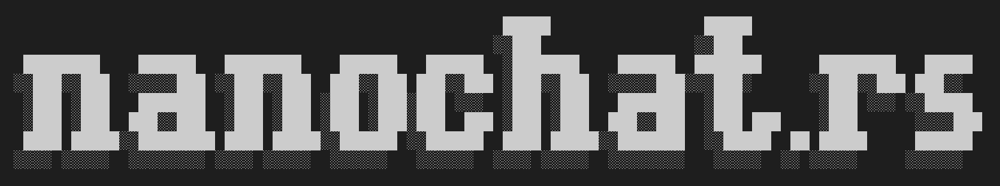

# nanochat.rs

A Rust port of Andrej Karpathy's [nanochat](https://github.com/karpathy/nanochat): a small ChatGPT-style language model that you can train, evaluate and chat with from one small codebase. It is built on [candle](https://github.com/huggingface/candle) and runs on a laptop CPU or on a GPU.

## Quick start

You need Rust (stable), `make` and `curl`. `python3` is needed only for the HumanEval task, in `make chat-eval` and in the tests. Everything here was built and tested on macOS; see [Platforms](#platforms) for Linux.

```sh
make get-d12      # download a 793 MB English chat model from Hugging Face
make chat         # talk to it; type "quit" to leave
make chat PROMPT="What is the capital of France?"
```

That model is a community checkpoint with 286M parameters, so expect fluent English and shaky facts. `make get-d8` fetches a smaller English base model (335 MB). A base model continues text; it has not been taught to chat.

```sh
make get-d8
make sample       # prints a few continuations
```

## How it works

1. **Tokenizer.** Text is cut into chunks with a regex, and each chunk is merged into tokens by byte-pair encoding, as in GPT-4. The vocabulary has 32,768 tokens. Nine of them are special markers: one starts every document, and the rest mark who is speaking and where a tool call begins and ends.
2. **Model.** A decoder-only Transformer reads the tokens so far and predicts the next one. Position is encoded by rotating the attention queries and keys. Most layers look back over only a quarter of the context; every fourth layer and the last one see all of it.
3. **Pretraining** (`base_train`). The model reads web text and learns to predict the next token. Documents are packed so that every row of a batch starts at the beginning of a document. Weight matrices are trained with Muon, embeddings and scalars with AdamW. The model size sets the amount of data, the batch size and the learning rates unless you override them.
4. **Fine-tuning** (`chat_sft`). Training continues on conversations: everyday chat (SmolTalk), multiple-choice questions (MMLU) and maths problems that call a calculator (GSM8K). Only the assistant's words count toward the loss, so the model learns to answer, not to ask.
5. **Chat** (`nanochat`). The conversation is turned into tokens and the model runs over it once. It then produces one token at a time, and a key-value cache keeps what was already computed so each new token is a small step. When the model writes a calculation between its tool markers, the program works out the result and feeds it back in.
6. **Evaluation.** `base_eval` measures a base model: bits per byte on held-out text, the CORE score (a set of in-context tasks) and a few text samples. `chat_eval` measures a chat model on ARC, MMLU, GSM8K and HumanEval.

## Commands

Run `make` to list them.

| Command | What it does |
|---|---|
| `make build` | Compile everything in release mode |
| `make chat` | Chat with a model; `PROMPT="..."` asks one question and exits |
| `make sample` | Print text samples from a base model |
| `make base-eval` | Evaluate a base model: CORE, bits per byte, samples |
| `make chat-eval` | Evaluate a chat model; `TASK=ARC-Easy` runs one task |
| `make get-d12` | Download an English chat model (793 MB) into `models` |
| `make get-d8` | Download a small English base model (335 MB) into `models` |
| `make data` | Download `N` training shards plus the validation shard |
| `make tok-train` | Train the tokenizer on the downloaded shards |
| `make base-train` | Pretrain a base model |
| `make chat-sft` | Fine-tune the base model into a chat model |
| `make test` | Run the tests (builds `tests/data` first if it is missing) |
| `make test-data` | Rebuild `tests/data` from the current code |
| `make bench` | Time prefill and decode on CPU |
| `make clean` | Remove build output |

Options go on the command line, for example `make chat FEATURES=metal TAG=d12`:

| Option | Meaning | Default |
|---|---|---|
| `FEATURES` | GPU backend: `metal` (Apple Silicon) or `cuda` (NVIDIA, untested) | CPU |
| `BASE` | Directory with checkpoints, tokenizer and data | `./models` |
| `SOURCE` | Checkpoints to load: `base`, `sft` or `rl` | `sft` |
| `TAG` | Model tag, such as `d12` | largest model found |
| `PROMPT` | One question for `make chat` | interactive |
| `TASK` | One task for `make chat-eval` | all tasks |
| `N` | Training shards for `make data` | 8 |
| `ARGS` | Extra arguments passed straight to the program | none |

Each program lists its own arguments with `--help`, for example `cargo run --release --bin base_train -- --help`.

## Train your own

This run takes a few minutes on a laptop CPU and goes through every step. `BASE=models/run` keeps it apart from the downloaded models, which use a different tokenizer.

```sh
make data N=1 BASE=models/run          # 1 training shard + the validation shard, about 90 MB each
make tok-train BASE=models/run ARGS="--max-chars=20000000"
make base-train BASE=models/run ARGS="--depth=4 --head-dim=64 --window-pattern=L --max-seq-len=512 \
    --device-batch-size=4 --total-batch-size=2048 --eval-every=-1 --core-metric-every=-1 \
    --sample-every=-1 --num-iterations=30"
make chat-sft BASE=models/run ARGS="--num-iterations=40 --eval-tokens=4096 --chatcore-every=-1"
make chat BASE=models/run
```

The result is a toy: it has seen about 60,000 tokens and answers with a letter or two. For a real model, raise `--depth` (the main size knob), the batch sizes and `--num-iterations`, and download more shards. A depth-4 model trains at about 1,800 tokens per second on an Apple M-series CPU, so anything worth talking to needs a GPU and a lot of patience. `--resume-from-step` continues a run from a saved checkpoint. The first `make chat-sft` downloads the fine-tuning datasets (about 1 GB).

## Where files live

Everything the programs read and write is under `models/`, which git ignores. Set `BASE` (or the `NANOCHAT_BASE_DIR` environment variable) to use another directory.

```
models/
├── tokenizer/                  tokenizer.json, or a tokenizer.pkl from the Python version
├── base_data_climbmix/         pretraining shards
├── base_checkpoints/<tag>/     model_<step>.safetensors (or .pt), meta_<step>.json, optimizer state
├── chatsft_checkpoints/<tag>/  the same, after fine-tuning
├── task_data/                  fine-tuning and evaluation datasets, fetched on first use
├── eval_bundle/                CORE tasks, fetched on first use
└── base_eval/                  CORE results written by `make base-eval`, one CSV per model
```

## Using other checkpoints

Checkpoints from the Python nanochat load directly, with no conversion step:

- **Weights:** `model_<step>.pt` or `model_<step>.safetensors`, next to a `meta_<step>.json` that holds the `model_config`. Tensor names must be the Python ones (`transformer.wte.weight`, ...); files that add a prefix such as `model.` will not load.
- **Tokenizer:** the Python version's `tokenizer.pkl`, or a Hugging Face `tokenizer.json` converted from one (special tokens numbered after the ordinary ones).

The checkpoint must use the current nanochat architecture (roughly March 2026 onward). Older ones, such as `karpathy/nanochat-d32`, have a different layout and will not load. One directory holds one tokenizer, so models trained with different tokenizers need separate `BASE` directories.

## Platforms

- **macOS (tested).** CPU math uses Apple's Accelerate framework. Add `FEATURES=metal` to run on the GPU of an Apple Silicon Mac. Metal gives the same results as the CPU for both chat and training; on small models it is not faster.
- **Linux (not tested).** Accelerate is switched on only for macOS, so a Linux build uses candle's built-in CPU backend. It has not been built or run there. The download code needs the OpenSSL development headers and `pkg-config`.
- **NVIDIA (not tested).** `FEATURES=cuda` selects candle's CUDA backend. It has never been built.

## Tests

`make test` runs the suite. The tests compare the code against inputs and expected outputs in `tests/data`, which is generated from fixed seeds by `make test-data` and is not checked in. They tell you whether behaviour changed since the data was generated, so regenerate it after an intended change. The HumanEval tests run Python code and need `python3` on the PATH.

## Differences from the Python version

- One process and one device: no multi-GPU training.
- 32-bit floats only: no bf16 or FP8.
- Not ported: reinforcement learning (`chat_rl`), the tokenizer evaluation, the inference benchmark script, and wandb logging.
- Files default to `./models`, not `~/.cache/nanochat`.
- Checkpoints are written as `.safetensors` and the tokenizer as `tokenizer.json`. The Python version reads neither, so models trained here cannot be loaded there.
- Fine-tuning cuts conversations to fit one row of the batch. The Python version always cuts at 2,048 tokens, so with a shorter context most conversations never fit and training ends up on empty batches.

## Code map

| Path | Contents |
|---|---|
| `src/main.rs` | Chat CLI |
| `src/bin/` | `base_train`, `base_eval`, `chat_sft`, `chat_eval`, `tok_train`, `dataset` |
| `src/nanochat/gpt.rs` | The model |
| `src/nanochat/engine.rs` | Generation with the key-value cache and the calculator tool |
| `src/nanochat/optim.rs` | Muon and AdamW |
| `src/nanochat/tokenizer.rs` | BPE tokenizer: training, encoding, chat rendering |
| `src/nanochat/tokenizer_import.rs` | Readers for `tokenizer.pkl` and Hugging Face `tokenizer.json` |
| `src/nanochat/dataloader.rs` | Batch packing for pretraining and fine-tuning |
| `src/nanochat/dataset.rs` | Pretraining shards: download and reading |
| `src/nanochat/checkpoint_manager.rs` | Saving and loading checkpoints |
| `src/nanochat/core_eval.rs`, `base_eval.rs`, `chat_eval.rs`, `loss_eval.rs` | The evaluations |
| `src/nanochat/execution.rs` | Sandbox that runs model-written Python for HumanEval |
| `src/nanochat/tasks/` | Datasets: SmolTalk, MMLU, GSM8K, ARC, HumanEval, fetched from the Hugging Face Hub by `hub.rs`. SpellingBee and CustomJSON are also there but unused by default |
| `examples/gen_test_data.rs` | Builds `tests/data` |
| `examples/bench.rs` | The `make bench` timing |
| `tests/` | The test suite |

## License

MIT. The design, architecture and training recipe are Andrej Karpathy's [nanochat](https://github.com/karpathy/nanochat).
